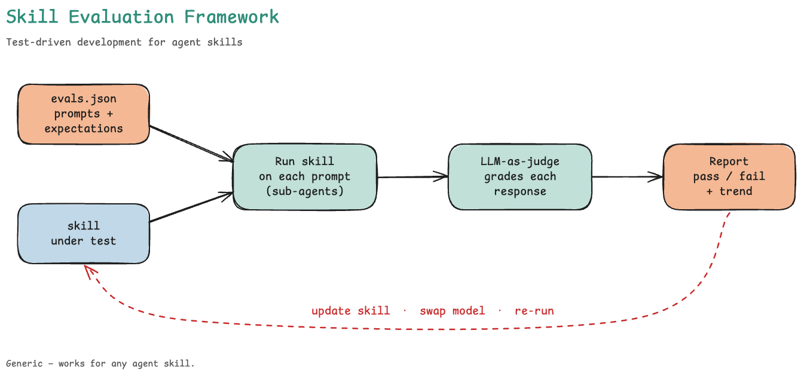

# Skill Eval Runner

> **Skill:** [`skills/skill-eval-runner/`](../../../skills/skill-eval-runner/) — see [SKILL.md](../../../skills/skill-eval-runner/SKILL.md) for the agent-facing definition.

Test-driven development for agent skills. Given a list of test cases (prompts + expectations), the skill-eval-runner executes each prompt against the skill, grades the responses with an LLM-as-judge, and produces a report you can re-open after every skill update or model swap to see how quality moves.



## Why This Exists

Three things become possible once a skill has an eval suite:

- **Catch regressions** before they ship — every change to a skill or its knowledge base runs the same prompts and you see what moved.
- **Benchmark models** on the skills *you actually care about* — swap the underlying model, re-run, compare. Public leaderboards don't reflect your prompts.
- **TDD for skills** — write the evals first, iterate the skill until the bar goes green. Same discipline you already use for code.

The framework is generic and works for any agent skill. We use it on REFLEX expert skills.

## End-to-End Workflow

```
/skill-eval-generator <skill-name>   →   scaffolds evals/skills/{skill}/evals.json
/skill-eval-runner    <skill-name>   →   executes, grades, opens the report
                                            ↑
                                        update skill, swap model, re-run
```

[`/skill-eval-generator`](../skill-eval-generator/README.md) browses a skill's SKILL.md and references to produce a starter `evals.json` with `[auto]`-prefixed expectations for human refinement. Once you have an `evals.json`, `/skill-eval-runner` takes over.

## Pipeline

The skill-eval-runner follows a 4-phase pipeline:

| Phase | What happens | Output |
|-------|-------------|--------|
| **PREPARE** | Reads `evals/skills/{skill-name}/evals.json`, validates test cases, sets up workspace | `workspace/` directory with per-eval folders |
| **EXECUTE** | Dispatches each test case to sub-agents that run the target skill | `response.md` + `metrics.json` per variant |
| **GRADE** | Grader (LLM-as-judge) scores each response against expectations, comparator does blind A/B | `grading.json`, `comparison.json`, `benchmark.json` |
| **REPORT** | Aggregates results, launches eval-viewer, presents summary | `benchmark.md`, eval-viewer HTML |

## Host Telemetry

The canonical finalizer supports optional VS Code debug logs and parent notification sidecars. Select only the telemetry options for the host actually running the evaluation; Copilot CLI-specific flags are not generic runner requirements.

### Copilot CLI post-exit usage (host/CI only)

The host/CI wrapper—not the skill agent—must request final usage when it launches Copilot CLI. The usage file is complete only after the CLI exits. Set `COPILOT_USAGE_FILE` to a writable private path; use `$RUNNER_TEMP` only when the host defines it. Run these commands from the `skill-eval/` directory, and give concurrent jobs isolated workspaces:

```bash
WORKSPACE="evals/skills/$SKILL/workspace"
COPILOT_SESSION_ID="$(python3 -c 'import uuid; print(uuid.uuid4())')"

copilot --session-id "$COPILOT_SESSION_ID" --usage-output-file "$COPILOT_USAGE_FILE" ...

# Run only after the Copilot CLI process exits.
COPILOT_EVENTS_FILE="${COPILOT_HOME:-$HOME/.copilot}/session-state/$COPILOT_SESSION_ID/events.jsonl"
python3 skills/skill-eval-runner/eval-viewer/generate_review.py \
  "$WORKSPACE" \
  --skill-name "$SKILL" \
  --usage-output-file "$COPILOT_USAGE_FILE" \
  --copilot-events-file "$COPILOT_EVENTS_FILE" \
  --static "$WORKSPACE/report.html"
```

Omitting `--iteration` lets the generator select the latest iteration in that workspace. The deterministic post-exit step writes a sanitized `usage_summary.json` without another model call or changes to `metrics.json` or `benchmark.json`. Session totals and per-agent details overlap and must not be added together. A session average is only a labeled display fallback, not measured per-run usage.

**Per-eval attribution.** Copilot CLI records each sub-agent's usage under its agent definition (for example `skill-eval-executor`), not under the task name the runner chose. The runner names every sub-agent after its eval, role, and variant (see *Sub-agent names* in the runner `SKILL.md`), and those names appear only in the CLI session events. `--session-id` fixes the session directory, and `--copilot-events-file` lets the generator join each sub-agent to its task name. Without the events file, or when it cannot be read, usage stays complete but is grouped under safe role labels (Runner, Executor, Grader, Comparator, Analyzer) instead of per eval; legacy `eval-N-role` display names still attribute. Sub-agents whose task names do not follow the convention are grouped the same way, and the generator warns when an events file attributes no sub-agent at all. Common variations (an eval slug before the role, `_` or spaces as separators, `with-skill` for `current-skill`) are accepted. A variant comes from the task name, or is inferred only when the eval ran a single variant.

The events file contains complete prompts and outputs. The generator reads only task names and agent ids from it, keeps them in memory, and writes none of them, nor any path, to `usage_summary.json` or the report. Keep the events file private and never commit or upload it.

VS Code's `--session-log` is only for runs hosted by VS Code Copilot Chat. Other compatible hosts should use only their own available task-result notification or log integration. The report shows per-run model and token details when present, `N/A` for unavailable run tokens, and session models in Pass Rate Trend, Health Signals, and Resource Usage when per-run model attribution is unavailable. Benchmark Cost Overhead separates executor-only, all eval-linked, and whole-session averages; token breakdowns and unlinked support-agent totals are collapsed by default. Token counts use compact notation with exact values on hover, and coverage is shown only when incomplete. The unlinked-agent table reuses the comparison columns and shows deltas/ratios only when source values are available; its iteration totals are already included in whole-session usage and must not be added again. Legacy caller-provided `session_usage.json` remains supported for historical data.

Routine report generation does not need Copilot CLI debug logs. If they are enabled for unrelated troubleshooting, they may contain complete request bodies and private inputs; keep them private and never commit or upload them.

## When To Use

- You updated a skill and want to verify it still passes its eval suite
- You updated a knowledge base and regenerated a skill
- You want to compare quality between two iterations of a skill

## When NOT To Use

- You want to create eval test cases — use [`/skill-eval-generator`](../skill-eval-generator/README.md) instead
- You want to validate repository structure — use `npm run validate` instead

## Usage

```
/skill-eval-runner skill-optimiser
```

The skill accepts any skill name that has a corresponding `evals/skills/{skill-name}/evals.json` file.

To list all skills with evals:
```bash
python skills/skill-eval-runner/scripts/list_evals.py
```

## Anatomy of an Eval

Each test case is a prompt plus a list of pass/fail expectations the response must meet:

```json
{
  "id": 1,
  "name": "import-validation-failure",
  "prompt": "The nightly import job failed with a record validation error...",
  "expectations": [
    "Response identifies record validation failure as root cause",
    "Confidence is HIGH or >= 80"
  ]
}
```

Expectations are graded individually by the LLM-as-judge — you see exactly which ones passed, which failed, and the verbatim evidence the judge looked at. See [schemas.md](../../../skills/skill-eval-runner/references/schemas.md) for the full `evals.json` spec including optional fields (`files`, `expected_output`, `skill_version`).

## Eval Viewer

The eval-viewer (`skills/skill-eval-runner/eval-viewer/`) provides a browser-based interface with three views:

- **Review** — per eval: prompt, response, per-expectation grading with evidence, and an A/B comparison between skill versions or against the no-skill baseline
- **Benchmark** — per iteration: headline pass rate, cost overhead, quality scores (radar + dumbbell), contradictions, skill regressions, per-eval scorecard
- **Progression** — across iterations: pass-rate trend, heatmap, resource usage, skill-feedback rollup — *the loop in action*

## Further Reading

- [SKILL.md](../../../skills/skill-eval-runner/SKILL.md) — full skill definition with phase details and agent coordination
- [schemas.md](../../../skills/skill-eval-runner/references/schemas.md) — authoritative JSON schemas for `evals.json`, `grading.json`, `benchmark.json`
- [skill-eval-grader.agent.md](../../../agents/skill-eval-grader.agent.md) — LLM-as-judge grading agent
- [skill-eval-analyzer.agent.md](../../../agents/skill-eval-analyzer.agent.md) — benchmark analysis agent
- [skill-eval-comparator.agent.md](../../../agents/skill-eval-comparator.agent.md) — A/B comparison agent
- [skill-eval-executor.agent.md](../../../agents/skill-eval-executor.agent.md) — test case execution agent

## Contributing

See [CONTRIBUTING.md](CONTRIBUTING.md) for how to improve the skill-eval-runner.
